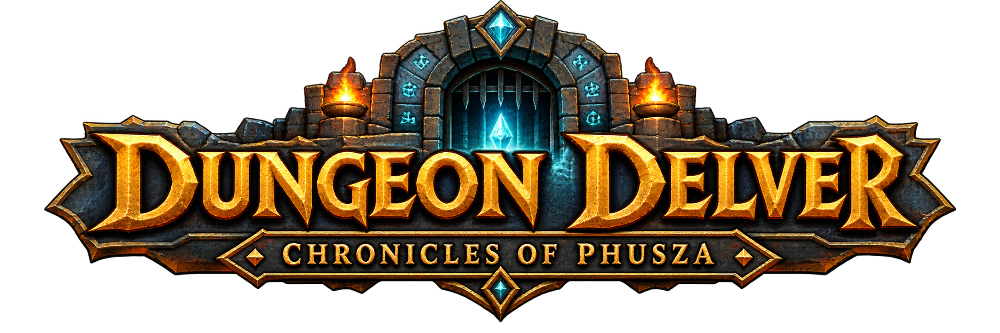

<div align="center">
  

  <h1>⚔️ Dungeon Delver: Chronicles of Phusza</h1>

  <p>
    <strong>A retro 8-bit inspired 3D Character Forge &amp; Point-and-Click Dungeon Crawler built with Three.js.</strong>
  </p>

  <p>
    
    
    
    
    
  </p>
</div>

---

## ✨ What We've Worked On So Far

A quick TL;DR of everything built and polished up to now:

- **🧙 3D Character Forge (`CharacterCreatorApp` & `CharacterBuilder`)** — Interactive 3D turntable hero creator with floating rune particles, shadow casting, drag/touch orbit, zoom wheel, and live stat bars.
- **🧬 6 Procedural Ancestries & 2 Classes** — Custom low-poly geometry, proportions, and perks for **Human, Elf, Dwarf, Orc, Goblin, and Catfolk**, paired with **Warrior** (plate, broadsword, shield) and **Mage** (robes, glowing crystal staff, arcane orb) loadouts.
- **🛡️ Full RPG Stats & Vitality Tracking** — Live calculation of **HP, MP, Strength, Vitality, Agility, and Intelligence**, plus ancestry-standardized terminology (`ANCESTRY_DATA`) and UI readouts.
- **🏰 3D Dungeon World (`DungeonWorldApp`)** — Isometric point-and-click exploration through the Lost Crypt with flickering wall torches, waypoint reticle, smooth camera tracking, and animated walk cycles.
- **🎲 D20 Skill Checks & 7 Interactive Encounters** — Proximity-triggered encounter modal with animated D20 rolls (`D20 + stat modifier vs DC`), Nat 20 crits, Nat 1 blunders, loot/XP rewards, hazards, and a live Crypt Chronicle log.
- **🔊 8-Bit Web Audio Synthesizer (`SoundController`)** — Procedural chiptune SFX (footsteps, ancestry swaps, class equips, dice clatter, fanfares, hits) with zero external audio files.
- **🎨 Branding & UI Polish** — Custom *Dungeon Delver: Chronicles of Phusza* logo assets, retro `Cinzel` + `VT323` HUD styling, refined panel spacing, and tuned preview camera distance.

---

## 🚀 Quick Start

Zero build step and zero npm dependencies — just Node.js and a browser.

```bash
# Start the local static dev server (defaults to port 8085)
npm start
# or
node server.js
```

Then open **`http://localhost:8085`** in your browser *(if port `8085` is busy, `server.js` automatically increments to the next free port, or you can set `PORT`)*.

---

## 🎮 How to Play & Controls

### 1. Character Forge
- **Customize Hero:** Enter a name, pick an **Ancestry** & **Class**, toggle headgear, and swap **Skin/Fur**, **Hair/Beard**, and **Armor/Robe** tints.
- **Inspect in 3D:** Drag (or swipe) to orbit, scroll to zoom, or use the **Left / Right** turntable buttons.
- **🎲 Random Hero:** Instantly rolls a full randomized hero build.
- **⚔️ Enter the Crypt:** Launches your hero straight into the 3D dungeon.

### 2. 3D Dungeon Adventure
- **Move:** Click anywhere on the dungeon floor to walk there.
- **Interact:** Click glowing beacons `[⯁]` or walk near Points of Interest to trigger encounters.
- **Resolve Encounters:** Choose a stat-based approach (`STR`, `AGI`, `INT`, or `VIT`) and roll the D20!
- **Top Bar:** Toggle **🔊 Sound** or hop back to **🏕️ Character Forge** anytime.

---

## 🧬 Roster & Encounters Overview

<details>
<summary><strong>6 Playable Ancestries &amp; 2 Classes</strong></summary>

| Ancestry | Trait / Perk | Visual Signature |
| :--- | :--- | :--- |
| 🧑 **Human** | *Adaptable* (`+2` all stats) | Balanced proportions, classic adventurer hair |
| 🧝 **Elf** | *Arcane Affinity* (`+4 AGI`, `+6 INT`, `+25 MP`) | Tall slender build, pointed ears, long flowing hair |
| 🧔 **Dwarf** | *Stoneheart* (`+4 STR`, `+6 VIT`, `+35 HP`) | Stout broad frame, thick mustache & golden-ringed beard |
| 👹 **Orc** | *Blood Rage* (`+8 STR`, `+1 AGI`, `-1 INT`, `+5 VIT`, `+30 HP`) | Hulking build, lower tusks, heavy brow & topknot |
| 👺 **Goblin** | *Nimble Skulker* (`-1 STR`, `+8 AGI`, `+3 INT`, `+1 VIT`, `+15 MP`) | Small nimble frame, hooked nose & wide bat ears |
| 🐱 **Catfolk** | *Feline Grace* (`+2 STR`, `+6 AGI`, `+2 INT`, `+3 VIT`) | Sleek build, perched cat ears, muzzle, whiskers & animated tail |

- **⚔️ Warrior** (*Whirlwind Slash*): Heavy plate, horned greathelm, steel broadsword & heraldic shield.
- **🔮 Mage** (*Firebolt*): Flowing robe & sash, pointed wizard hat, crystal staff & floating arcane orb.

</details>

<details>
<summary><strong>7 Dungeon Encounters (Crypt of Eldoria)</strong></summary>

1. 🚪 **Rusted Iron Portcullis** — Force open (`STR`) or pick the counterweight lock (`AGI`).
2. ⚰️ **Sunken Sarcophagus** — Heave the granite lid (`STR`) or dispel the tomb curse (`INT`).
3. 🔮 **Arcane Leyline Monolith** — Attune to cosmic runes (`INT`) to restore & empower Mana.
4. 🕳️ **Concealed Spike Pit** — Leap across the chasm (`AGI`) to dodge iron spikes.
5. 💀 **Skeletal Vanguard** — Cleave the undead (`STR`) or cast a magical disruption (`INT`).
6. ⛲ **Sacred Healing Font** — Drink from the enchanted basin (`VIT`) for full HP/MP recovery.
7. 👑 **The Crown Vault Chest** — Disarm triple dragon-skull locks (`AGI`) or smash the clasps (`STR`) to claim the **Crown of Eldoria**.

</details>

---

## 📁 Project Structure

```text
dungeon_delver/
├── index.html                           # App shell, Forge & Adventure HUDs, D20 modal & UI wiring
├── server.js                            # Zero-dependency Node.js static file server (default :8085)
├── package.json                         # Project metadata & start script
├── dungeon_delver_chronicles-of-phusza.png  # Title banner artwork
├── dungeon_delver_logo_small.png        # Header emblem icon
├── js/
│   ├── stats.js                         # ANCESTRY_DATA, CLASS_DATA & stat/HP/MP formulas
│   ├── characterBuilder.js              # Procedural 3D low-poly character & gear generator
│   ├── characterCreator.js              # Forge 3D scene, turntable controls, pedestal & particles
│   ├── dungeonWorld.js                  # 3D Crypt map, torches, point-and-click locomotion & POIs
│   ├── encounters.js                    # 7 dungeon encounter definitions, DCs, rewards & hazards
│   ├── dice.js                          # D20 roll engine, stat modifiers & roll animation loop
│   └── audio.js                         # 8-bit Web Audio API sound synthesizer
└── vendor/
    └── three.module.js                  # Vendored Three.js r160 ES module
```

---

<div align="center">
  <sub>Built with Three.js r160 · Web Audio API · Vanilla ES Modules</sub>
</div>
