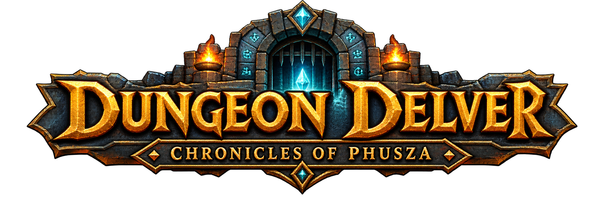

<div align="center">
  

  <h1>⚔️ Dungeon Delver: Chronicles of Phusza</h1>

  <p>
    <strong>A retro 8-bit inspired 3D Character Forge &amp; Point-and-Click Dungeon Crawler built with Three.js.</strong>
  </p>

  <p>
    
    
    
    
    
  </p>
</div>

---

## ✨ What We've Worked On So Far

A quick TL;DR of everything built and polished up to now:

- **🧙 3D Character Forge (`CharacterCreatorApp` & `CharacterBuilder`)** — Interactive 3D turntable hero creator with floating rune particles, shadow casting, drag/touch orbit, zoom wheel, and live stat bars.
- **🧬 6 Procedural Ancestries & 2 Classes** — Custom low-poly geometry, proportions, and perks for **Human, Elf, Dwarf, Orc, Goblin, and Catfolk**, paired with **Warrior** (plate, broadsword, shield) and **Mage** (robes, glowing crystal staff, arcane orb) loadouts.
- **🛡️ Full RPG Stats & Vitality Tracking** — Live calculation of **HP, MP, Strength, Vitality, Agility, and Intelligence**, plus ancestry-standardized terminology (`ANCESTRY_DATA`) and UI readouts.
- **🏰 3D Floor 1 Horror Dungeon (`DungeonWorldApp` & `floor1Layout.js`)** — A claustrophobic entrance vestibule (*Cracked Threshold*) leading into **Room 1** (*Hall of Fallen Torches*) and **5 interconnected chambers + side wings** culminating in the **Floor 1 Exit Seal**. Features fog-of-war room shrouds, low South cutaway walls for clear isometric sightlines, universal flickering player torchlight, and pooled dynamic lights.
- **⚔️ Strict Monster-XOR-Trap Room Inhabitation (`encounters.js`, `combat.js`, `overworldProps.js`)** — Every combat/hazard chamber on Floor 1 is inhabited **exclusively by monsters OR exclusively by traps** (never both in the same room), with 4 procedural 3D monster types (`skeleton`, `crypt_ghoul`, `crypt_spider`, `shadow_wraith`) and 4 mechanical trap archetypes (`spike_pit`, `pendulum_blade`, `poison_dart_wall`, `cursed_pressure_plate`).
- **🎲 D20 Skill Checks, Retryable Doors & Turn-Based 3D Combat** — Proximity-triggered encounter modal with animated D20 rolls (`D20 + stat modifier vs DC`), retryable iron portcullises, true `0-HP` trap lethality with entrance revival, monster special attacks, and a Floor 1 Victory modal.
- **🔊 8-Bit Web Audio Synthesizer & Crypt Music (`audio.js` & `music.js`)** — Procedural chiptune SFX (footsteps, trap triggers/disarms, iron doors, monster growls, dread stingers, room discoveries) and atmospheric crypt music with zero external audio files.
- **🎨 Horror Atmosphere & UI Polish** — Live `#hudRoom` room banner, first-entry `.log-msg.dread` whispers, dark radial vignette with low-HP crimson pulse (`<= 35%` HP), damage screen shake, and retro `Cinzel` + `VT323` HUD styling.

---

## 🚀 Quick Start

Zero build step and zero npm dependencies — just Node.js and a browser.

```bash
# Start the local static dev server (defaults to port 8085)
npm start
# or
node server.js

# Run unit tests (Node built-in test runner)
npm test
```

Then open **`http://localhost:8085`** in your browser *(if port `8085` is busy, `server.js` automatically increments to the next free port, or you can set `PORT`)*.

---

## 🎮 How to Play & Controls

### 1. Character Forge
- **Customize Hero:** Enter a name, pick an **Ancestry** & **Class**, toggle headgear, and swap **Skin/Fur**, **Hair/Beard**, and **Armor/Robe** tints.
- **Inspect in 3D:** Drag (or swipe) to orbit, scroll to zoom, or use the **Left / Right** turntable buttons.
- **🎲 Random Hero:** Instantly rolls a full randomized hero build.
- **⚔️ Enter the Crypt:** Launches your hero straight into Floor 1 of the dungeon.

### 2. 3D Dungeon Adventure (Floor 1)
- **Move (Click or Keyboard):** Click anywhere on the dungeon floor to pathfind (`A*` grid navigation) through doorways and around walls, or hold **WASD / Arrow Keys** for direct movement with wall-sliding collision.
- **Interact:** Walk near or click glowing encounter beacons (`[⚔]` Monsters, `[⚠]` Traps, `[⚿]` Doors, `[✚]` Curios, `[⏬]` Exit) to trigger encounters.
- **Resolve Encounters & Combat:** Choose a stat-based D20 check (`STR`, `AGI`, `INT`, or `VIT`) or fight in turn-based 3D combat using basic strikes, class specials, guard stance, consumables, or tactical retreat.
- **Top Bar:** Toggle **🎵 Music** (`M`), **🔊 SFX**, or return to **🏕️ Character Forge** / **🏰 Title** anytime.

---

## 🧬 Roster & Floor 1 Encounters Overview

<details>
<summary><strong>6 Playable Ancestries &amp; 2 Classes</strong></summary>

| Ancestry | Trait / Perk | Visual Signature |
| :--- | :--- | :--- |
| 🧑 **Human** | *Adaptable* (`+2` all stats) | Balanced proportions, classic adventurer hair |
| 🧝 **Elf** | *Arcane Affinity* (`+4 AGI`, `+6 INT`, `+25 MP`) | Tall slender build, pointed ears, long flowing hair |
| 🧔 **Dwarf** | *Stoneheart* (`+4 STR`, `+6 VIT`, `+35 HP`) | Stout broad frame, thick mustache & golden-ringed beard |
| 👹 **Orc** | *Blood Rage* (`+8 STR`, `+1 AGI`, `-1 INT`, `+5 VIT`, `+30 HP`) | Hulking build, lower tusks, heavy brow & topknot |
| 👺 **Goblin** | *Nimble Skulker* (`-1 STR`, `+8 AGI`, `+3 INT`, `+1 VIT`, `+15 MP`) | Small nimble frame, hooked nose & wide bat ears |
| 🐱 **Catfolk** | *Feline Grace* (`+2 STR`, `+6 AGI`, `+2 INT`, `+3 VIT`) | Sleek build, perched cat ears, muzzle, whiskers & animated tail |

- **⚔️ Warrior** (*Whirlwind Cleave*): Heavy plate, horned greathelm, steel broadsword & heraldic shield.
- **🔮 Mage** (*Firebolt Flare*): Flowing robe & sash, pointed wizard hat, crystal staff & floating arcane orb.

</details>

<details>
<summary><strong>Floor 1 Monsters &amp; Trap Archetypes</strong></summary>

**Monsters (Combat Rooms):**
1. 💀 **Skeletal Vanguard** (`skeleton`) — Rusted Greatsword & *Bone-Shatter Overhead* special.
2. 🧟 **Flesh-Starved Crypt Ghoul** (`crypt_ghoul`) — Raking Claws & *Paralytic Frenzied Bite* special.
3. 🕷️ **Chitinous Crypt Spider** (`crypt_spider`) — Venomous Fang Lunge & *Necrotic Web Spit* special.
4. 👻 **Weeping Shadow Wraith** (`shadow_wraith`) — Soul-Chill Touch & *Dread Wail of the Ossuary* special.

**Traps (Trap Rooms):**
1. 🕳️ **Concealed Spike Pit** (`spike_pit`) — Leap across (`AGI`) or brace through the iron spikes (`VIT`).
2. 🪓 **Swinging Pendulum Scythe** (`pendulum_blade`) — Time a dash (`AGI`) or jam the wall gear (`STR`).
3. 🎯 **Venom-Tipped Dart Wall** (`poison_dart_wall`) — Plug the murder holes (`INT`) or endure the volley (`VIT`).
4. 🔯 **Cursed Blood-Rune Plate** (`cursed_pressure_plate`) — Scratch a counter-sigil (`INT`) or leap clear (`AGI`).

**Doors, Curios & Exit:**
- 🚪 **Rusted Iron Portcullis & Whispering Bone-Latched Door** (retryable until unlocked)
- ⚰️ **Sunken Sarcophagus**, 🔮 **Arcane Leyline Monolith**, ⛲ **Sacred Healing Font**
- 👑 **The Crown Vault Chest** & ⏬ **The Abyssal Seal — Floor 1 Exit**

</details>

---

## 📁 Project Structure

```text
dungeon_delver/
├── index.html                           # App shell, Title/Forge/Adventure HUDs, modals & controller
├── server.js                            # Zero-dependency Node.js static file server (default :8085)
├── package.json                         # Project metadata, start & test scripts
├── dungeon_delver_chronicles-of-phusza.png  # Title banner artwork
├── dungeon_delver_logo_small.png        # Header emblem icon
├── js/
│   ├── titleScene.js                    # 3D Title screen backdrop & runic arch
│   ├── stats.js                         # ANCESTRY_DATA, CLASS_DATA & stat/HP/MP formulas
│   ├── characterBuilder.js              # Procedural 3D low-poly character & gear generator
│   ├── characterCreator.js              # Forge 3D scene, turntable controls, pedestal & particles
│   ├── floor1Layout.js                  # Floor 1 room graph, doorways, 2D nav-grid & A* pathfinder
│   ├── encounters.js                    # Per-run Floor 1 encounter factory, traps, doors, curios & exit
│   ├── overworldProps.js                # Procedural 3D overworld monster, trap, door & horror prop meshes
│   ├── dungeonWorld.js                  # Multi-room 3D Crypt renderer, shrouds, WASD + click locomotion
│   ├── combat.js                        # 4 Floor 1 monsters, special attacks, consumables & CombatStage3D
│   ├── dice.js                          # D20 roll engine, stat modifiers & roll animation loop
│   ├── audio.js                         # 8-bit Web Audio API sound synthesizer & horror SFX
│   └── music.js                         # Procedural orchestral/synth music & dread stingers
├── tests/
│   ├── unit/                            # Fast Node.js unit test suites (floor1, combat, audio, world, controller)
│   └── e2e/                             # Headless Chromium CDP + visual E2E test harness
└── vendor/
    └── three.module.js                  # Vendored Three.js r160 ES module
```

---

<div align="center">
  <sub>Built with Three.js r160 · Web Audio API · Vanilla ES Modules</sub>
</div>
